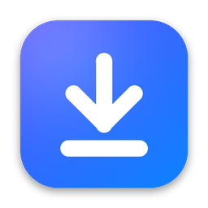

<h1 align="center">Video Downloader</h1>

A free app for Mac and Windows that saves videos, photos and music from YouTube, Instagram, Pinterest, Facebook, TikTok, X, SoundCloud and about 1,000 other sites. Made by Tanvir for video editors.

  <a href="https://github.com/tanvirr0071/video-downloader/releases/latest/download/Video-Downloader-by-Tanvir-Mac.zip"><b>Download for Mac</b></a> ·
  <a href="https://github.com/tanvirr0071/video-downloader/releases/latest/download/Video-Downloader-by-Tanvir-Windows.zip"><b>Download for Windows</b></a> ·
  <a href="https://tanvirr0071.github.io/video-downloader/">Website</a>

---

## What it does

- **Editing MP4**: H.264 video with AAC audio that opens in Premiere Pro, After Effects and CapCut without converting.
- **Max quality**: the sharpest version a site has, up to 4K and 8K.
- **Audio**: FLAC, MP3 320 kbps, or Original M4A (the site's own audio, untouched), with cover art and track names.
- **Photos**: Instagram posts and carousels, Pinterest pins and boards, X and Reddit images, at original resolution.
- Paste several links at once, save whole playlists and boards, grab thumbnails and subtitles, and reach private posts through the browser you are already logged in to.

## Install

**Mac** (macOS 11 or newer, Apple Silicon or Intel)
1. Download and unzip. Drag **Video Downloader** into Applications.
2. Open it. macOS says it can't verify the app: click **Done**.
3. Open **System Settings → Privacy & Security**, scroll down and click **Open Anyway**.
4. Wait about a minute while it sets itself up. The window opens by itself.

**Windows** (Windows 10 or 11, 64-bit)
1. Download, right-click the zip and choose **Extract All**.
2. Double-click **Start Video Downloader**. If Windows says it protected your PC, click **More info → Run anyway**.
3. Wait a minute or two while it sets itself up. The app opens in your browser.

Each download includes a full **READ ME FIRST** guide in English and Bangla.

## If something goes wrong

When a download fails, the app writes what to do right under it. Common fixes:

- **Private posts, Instagram photos, age-restricted videos**: log in to the site in your browser, then pick that browser in the app's login menu. On Windows use Firefox.
- **Mac says the app is damaged**: run `xattr -cr "/Applications/Video Downloader.app"` in Terminal, then open it again.
- **"The site refused the download"**: wait a few minutes. The app updates its download engine every day.

## Please use it fairly

Save videos, photos and music you made, own, or have permission to use. Re-uploading other people's work can get your account a copyright strike. DRM-protected services such as Netflix, Spotify and Apple Music can't be downloaded.

---

## বাংলা

একটা ফ্রি অ্যাপ, Mac আর Windows-এর জন্য। YouTube, Instagram, Pinterest, Facebook, TikTok, X, SoundCloud সহ প্রায় ১০০০ সাইট থেকে ভিডিও, ছবি আর গান নামানো যায়। ভিডিও এডিটরদের জন্য বানিয়েছে Tanvir।

**ডাউনলোড:** উপরের **Download for Mac** বা **Download for Windows** লিংকে চাপো।

**Mac-এ ইনস্টল**
১. zip খুলে **Video Downloader** টেনে Applications-এ রাখো।
২. খোলো। macOS যাচাই করতে পারছে না বললে **Done** চাপো।
৩. **System Settings → Privacy & Security**-এ নিচে গিয়ে **Open Anyway** চাপো।
৪. প্রায় ১ মিনিট অপেক্ষা করো, উইন্ডো নিজেই খুলবে।

**Windows-এ ইনস্টল**
১. zip-এ রাইট-ক্লিক করে **Extract All** করো।
২. **Start Video Downloader**-এ ডাবল-ক্লিক করো। "Windows protected your PC" দেখালে **More info → Run anyway**।
৩. ১-২ মিনিট অপেক্ষা করো, অ্যাপ ব্রাউজারে খুলবে।

প্রতিটা ডাউনলোডের ভেতরে বাংলা ও ইংরেজিতে পুরো গাইড (**READ ME FIRST**) আছে। নিজের বানানো, নিজের মালিকানার, বা অনুমতি আছে এমন কনটেন্টই নামাও।

---

Built on yt-dlp, gallery-dl, FFmpeg, uv and other open-source projects. See [THIRD-PARTY-NOTICES.md](THIRD-PARTY-NOTICES.md).
